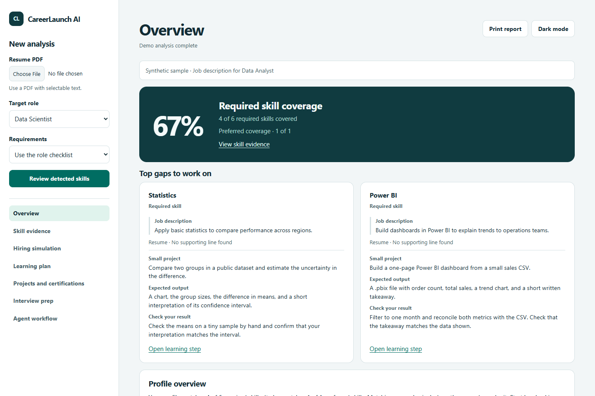
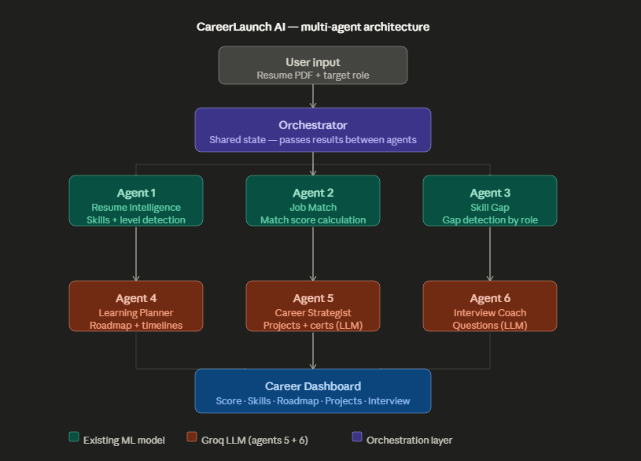
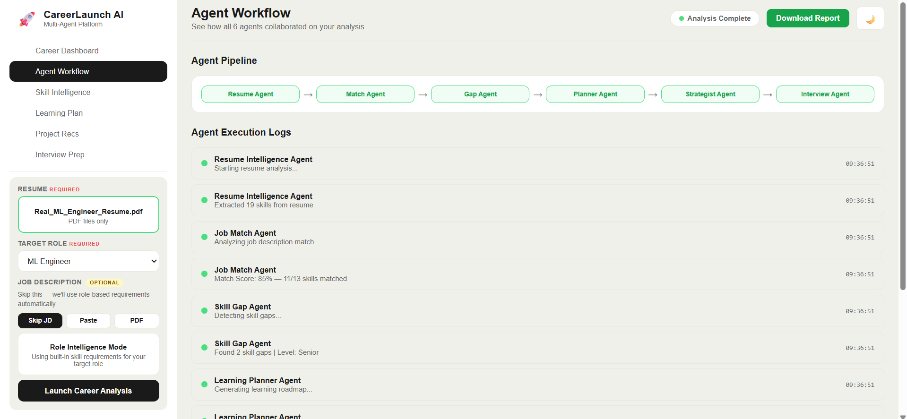
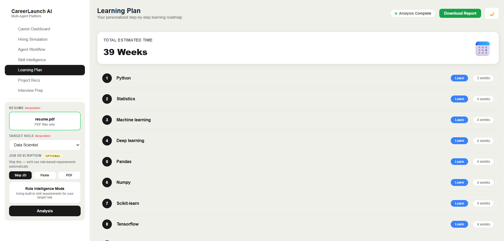

#  CareerLaunch AI — Multi-Agent Career Intelligence Platform

> An AI-powered multi-agent career strategist that analyzes resumes, reasons about career goals, identifies skill gaps, creates personalized learning plans, recommends projects, simulates the hiring process, and prepares users for interviews.



##  Architecture


---

##  Microsoft Agents League Hackathon Submission

**Team:** Solo Participant — Madhav  
**Category:** Multi-Agent AI Systems  
**Tech Stack:** Python · PyTorch · Flask · Groq LLM · HTML/CSS/JS

---

##  What Is CareerLaunch AI?

CareerLaunch AI is a **multi-agent career intelligence platform** that transforms a raw resume into a complete career strategy using 7 specialized AI agents working in sequence.

Unlike traditional resume analyzers that produce a single score, CareerLaunch AI simulates a team of career specialists — each agent reasoning about a different dimension of your career readiness and passing insights to the next. It goes a step further than any typical resume checker by simulating the **entire hiring pipeline** — ATS, Recruiter, Hiring Manager, and Technical Panel — and predicting your real shortlisting probability.

---

##  The Multi-Agent Architecture

```
User Input (Resume + Target Role)
            ↓
    ┌───────────────────┐
    │    Orchestrator    │
    │  (Shared State)    │
    └───────────────────┘
            ↓
┌─────────────────────────────────────────────────────────────┐
│                                                               │
│  Agent 1          Agent 2          Agent 3                   │
│  Resume           Job Match        Skill Gap                 │
│  Intelligence  →  Agent        →   Agent                     │
│                                                               │
│  Agent 4          Agent 5          Agent 6                    │
│  Learning      →  Career       →   Interview                 │
│  Planner          Strategist       Coach                     │
│                                                               │
│  Agent 7                                                      │
│  Hiring Simulation                                            │
│  (ATS → Recruiter → Hiring Manager → Technical Panel)         │
│                                                               │
└─────────────────────────────────────────────────────────────┘
            ↓
    Career Dashboard + Hiring Simulation
```

### Agent Responsibilities

| Agent | Role | Technology |
|-------|------|------------|
|  Resume Intelligence Agent | Parses resume, extracts skills, detects experience level | Custom Siamese Transformer |
|  Job Match Agent | Compares resume skills vs job requirements, calculates match % | Custom ML Model |
|  Skill Gap Agent | Identifies missing skills, prioritizes gaps by role | Rule-based + NLP |
|  Learning Planner Agent | Builds dependency-ordered learning roadmap with time estimates | Graph-based Engine |
|  Career Strategist Agent | Recommends projects, certifications, career strategy, and risk assessment | Groq LLM (Llama 3) |
|  Interview Coach Agent | Generates role-specific technical, behavioral, project questions | Groq LLM (Llama 3) |
|  Hiring Simulation Agent | Simulates ATS, Recruiter, Hiring Manager and Technical Panel review, producing a final hiring verdict and shortlisting probability | Groq LLM (Llama 3) |

---

##  Key Features

- ** Role Intelligence Mode** — No job description needed. The system knows what each role requires built-in.
- ** JD Upload Support** — Upload a PDF job description for precise matching.
- ** Career Readiness Score** — A single 0–100 score synthesizing all agent outputs.
- ** AI Hiring Simulation** — Simulates a full hiring pipeline (ATS Scanner → Recruiter → Hiring Manager → Technical Panel) with a final hire/maybe/reject verdict.
- ** Shortlisting Probability** — Predicts your real chance of getting shortlisted for the role.
- ** Hiring Risk Assessment** — Highlights high, medium, and low risk factors that could affect your candidacy.
- ** Learning Roadmap** — Dependency-ordered skill learning plan with Coursera links.
- ** Project Recommendations** — 3 real projects tailored to your skill gaps.
- ** Certification Guidance** — Role-specific certifications with direct links.
- ** Interview Preparation** — Technical, behavioral, and project-based questions.
- ** Download Report** — Export complete career analysis as PDF.
- ** Dark Mode** — Full light/dark theme support.

---

##  Screenshots

### Career Dashboard


### Agent Workflow


### Learning Plan


---

##  Project Structure

```
careerlaunch-ai/
│
├── agents/                      # 7 specialized AI agents
│   ├── base_agent.py            # Base class with logging
│   ├── resume_agent.py          # Agent 1 — Resume parsing
│   ├── match_agent.py           # Agent 2 — Job matching
│   ├── skill_gap_agent.py       # Agent 3 — Gap detection
│   ├── learning_planner.py      # Agent 4 — Roadmap generation
│   ├── career_strategist.py     # Agent 5 — LLM strategy + risk assessment
│   ├── interview_coach.py       # Agent 6 — LLM interview prep
│   └── hiring_simulation.py     # Agent 7 — LLM hiring pipeline simulation
│
├── core/
│   ├── orchestrator.py          # Runs all 7 agents in sequence
│   └── state.py                 # Shared state object
│
├── models/                      # Custom Siamese Transformer
├── checkpoints/                 # Trained model weights
├── training/                    # Model training scripts
├── utils/                       # Helper utilities
│
├── api.py                       # Flask REST API
├── engine.py                    # Core skill extraction engine
├── index.html                   # Frontend UI
└── requirements.txt
```

---

##  How To Run

### Prerequisites
- Python 3.9+
- Groq API Key (free at [console.groq.com](https://console.groq.com))

### Installation

```bash
# Clone the repository
git clone https://github.com/madhav1431-create/career-launch-ai.git
cd career-launch-ai

# Install dependencies
pip install -r requirements.txt

# Create .env file
echo "GROQ_API_KEY=your_groq_api_key_here" > .env
```

### Running The App

```bash
# Start the Flask API
python api.py
```

Then open `index.html` in your browser.

---

##  How It Works

1. **Upload Resume** — Upload your resume PDF
2. **Select Target Role** — Choose from Data Scientist, ML Engineer, Data Analyst, Backend Developer, AI Engineer, Frontend Developer
3. **Job Description (Optional)** — Paste or upload a JD, or skip to use Role Intelligence Mode
4. **Launch** — All 7 agents run in sequence, each building on the previous agent's output
5. **Explore Results** — Navigate through Dashboard, Hiring Simulation, Agent Workflow, Skills, Learning Plan, Projects, and Interview Prep tabs
6. **Hiring Simulation** — See how an ATS, Recruiter, Hiring Manager, and Technical Panel would evaluate your profile, along with a final verdict and shortlisting probability
7. **Download Report** — Export your complete career analysis as a PDF

---

##  The Shared State Architecture

All agents communicate through a shared state object — the core pattern of modern agent frameworks:

```python
state = {
    "resume_skills": [],          # Populated by Agent 1
    "match_score": 0,              # Populated by Agent 2
    "missing_skills": [],          # Populated by Agent 3
    "roadmap": [],                  # Populated by Agent 4
    "career_strategy": "",          # Populated by Agent 5
    "risk_assessment": {},           # Populated by Agent 5
    "interview_questions": [],       # Populated by Agent 6
    "hiring_simulation": {},          # Populated by Agent 7
    "shortlisting_probability": 0,    # Populated by Agent 7
    "agent_logs": []                   # Updated by all agents
}
```

---

##  Why This Satisfies Multi-Agent Requirements

| Microsoft Requirement | CareerLaunch AI Solution |
|----------------------|--------------------------|
| Multi-Agent System | 7 specialized agents with distinct roles |
| Agent Reasoning | Each agent reasons about its specific domain |
| Multi-step Planning | Resume → Skills → Gaps → Roadmap → Strategy → Hiring Simulation |
| Agent Collaboration | Shared state with sequential agent execution |
| Safe AI | Deterministic roadmap + structured LLM outputs |
| Real-world Impact | Solves career planning and hiring readiness for millions of job seekers |

---

##  Tech Stack

| Layer | Technology |
|-------|-----------|
| Custom ML Model | PyTorch — Siamese Transformer for skill similarity |
| LLM | Groq API — Llama 3.3 70B for strategy, interview prep, and hiring simulation |
| Backend | Python + Flask |
| Frontend | HTML + CSS + JavaScript |
| PDF Parsing | pdfplumber |
| Skill Graph | Custom dependency graph with topological sorting |

---

##  Model Details

CareerLaunch AI uses a **custom-trained Multi-task Siamese Transformer** for:
- Resume ↔ Job Description similarity scoring
- Multi-label skill extraction from 60+ skill vocabulary
- Experience level classification (Beginner / Mid / Senior)

This is not a wrapper around existing APIs — the core matching intelligence is a model trained specifically for career document analysis.

---

##  Developer

**Madhav**  
GitHub: [@madhav1431-create](https://github.com/madhav1431-create)

---

##  License

MIT License — feel free to use and build on this project.